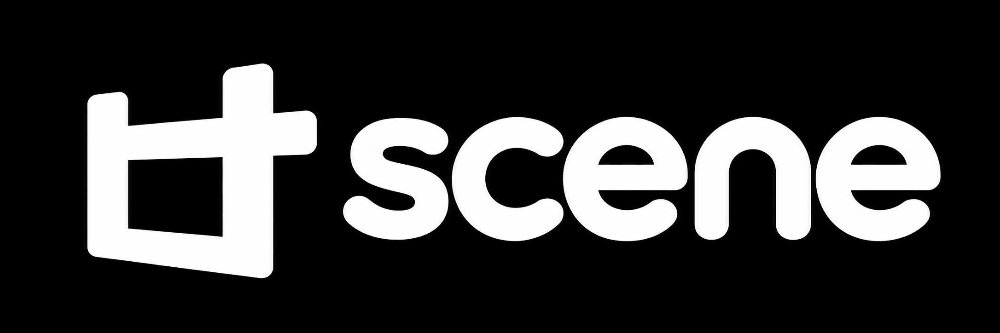
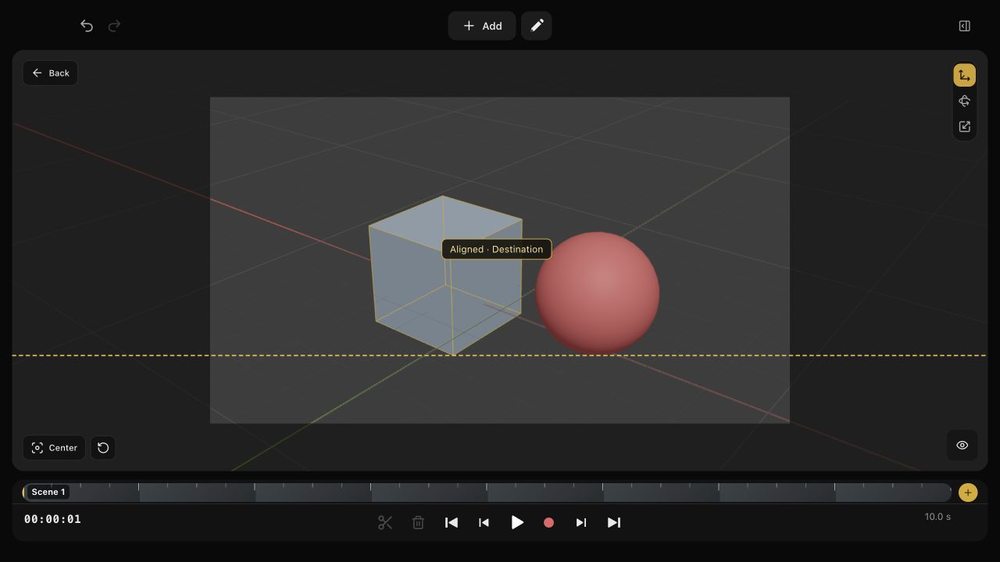

<p align="center"></p>

# Scene

Scene is a local desktop editor for 3D storyboards and animatics. Compose shots, draw object motion, record timing, edit audio and video, and export an editable Blender project. Blender is required for 3D production and rendering; drawing and editing do not require an AI account.



## Download 0.59.22

- [macOS — Apple Silicon (M1 or later), ZIP](https://github.com/sudoantonio/Scene/releases/download/v0.59.22/Scene-0.59.22-mac-arm64.zip)
- [Linux — x86_64, AppImage](https://github.com/sudoantonio/Scene/releases/download/v0.59.22/Scene-0.59.22-linux-x64.AppImage)
- [Source code, ZIP](https://github.com/sudoantonio/Scene/releases/download/v0.59.22/Scene-0.59.22-sources.zip)

See the [release page](https://github.com/sudoantonio/Scene/releases/tag/v0.59.22) for SHA-256 checksums and verification notes. Extract the Mac ZIP and move the app to Applications. The Mac build is not Developer ID signed or notarized. Linux: mark the AppImage executable (`chmod +x Scene-0.59.22-linux-x64.AppImage`) and open it. The AppImage uses FUSE 2; `--appimage-extract-and-run` is an alternative when FUSE is unavailable.

## Drawing and motion

Click the pencil beside **Add**, click the object to move, then click the destination. Clicking the first object again deselects it. Press and drag normally on the first object, then release on the second. The circle remains visible; use the wheel to resize it even during the gesture.

The selected surface points determine view-parallel start and arrival planes. Scene finds a shortest path on the surface represented by the drawn stroke. Ordinary motion stores the curve and two endpoint keyframes; **REC** preserves the gesture duration and pauses. Each completed motion or recording is one undo operation. Select a motion to give Jev optional instructions to adjust its duration and pacing.

The pencil menu also offers **Stroke** for permanent 3D tube geometry. Strokes, imported geometry, text, and other visible elements participate in positioning; a sample uses no more than 50 nearby inputs. Jev guidance is optional and keeps the last valid parameters if the service is unavailable. TypeSafe/Jev credentials belong in Settings.

## Editing

- Strong alignment snaps to centres, edges, and contacts; yellow guides show the matching anchor. Capture is 16 pixels with a 28-pixel release band. Hold **Alt** to bypass snapping.
- Camera-view guides follow projected object bounds; free-view guides use 3D coordinates. Fixed 2D layers have their own guides.
- Move, trim, resize, and split audio/video clips. Delete an empty timeline interval to close the gap and shift everything after it.
- The collapsed timeline shows scene names at the start of each block. **Stage and background** stays open in Scenography.
- The interface is in English. Existing project names and authored text remain unchanged.
- Interface zoom defaults to 110%; use Cmd/Ctrl `+`, `-`, or `0` to adjust or reset it.
- Save portable projects, export Blender curves and object animation, and export edited audio and subtitles.

## MCP

Scene includes 17 MCP tools for scene state, authorized assets, storyboard, motion, camera previews, validation, saving, portable folders, and Blender export. Keep Scene open while using its launcher.

On macOS, use `Scene-0.59.22.app/Contents/Resources/scene-mcp` as the MCP command. On Linux, extract the AppImage with `--appimage-extract` and use `squashfs-root/resources/scene-mcp`; launch Scene from that extracted folder. The launcher runs the bundled Electron runtime and requires no separate Node installation. The bridge is authenticated and accepts only local loopback connections. Test profiles, credentials, and personal settings are not distributed.

## Development and packaging

Use Node.js 22 and pnpm 11.19.0. The committed lockfile fixes dependency versions.

```sh
npm install -g pnpm@11.19.0
pnpm install --frozen-lockfile
pnpm run dev
pnpm test
pnpm run build
pnpm run package:mac     # macOS ARM64 host
pnpm run package:linux   # Linux x86_64 host
# Cross-build on macOS with Docker Desktop already running:
bash scripts/build-linux-container.sh
```

The Linux build is tested in an isolated Linux environment with Xvfb. Verification checks the native packaged app and its MCP launcher; evidence includes a rendered camera frame and a verification report. `scripts/verify-desktop-package.mjs` checks a local package with a separate user profile; `scripts/verify-mcp-alignment.mjs` additionally verifies actual Blender/WAV export on a Mac with Blender installed.

The viewport shares primitive geometry, batches large sets of simple objects, caches animation evaluation, renders idle scenes on demand, and virtualizes timeline rows. Local measurements with a 462 × 632 viewport and 110% interface zoom reached about 60 FPS for 1,000 simple forms and 45 FPS for 3,000 forms with the timeline open. Ten percent of the objects were animated; a reference path had 10,000 points. These measurements do not guarantee Blender performance or performance with complex imported models. Reproduce them with `?performance-test=1000` or `?performance-test=3000&expanded-timeline` and the benchmark scripts.

## Status and license

Scene is experimental and focused on previsualization. AI integrations are optional; local Laya support remains experimental. Linux local audio transcription is not included in this release; the bundled Whisper engine is for Apple Silicon Macs. Projects remain readable by the updated editor, including existing projects.

Scene is developed by Abaco Animation for ABACO. Released under [Apache License 2.0](LICENSE); retain [NOTICE](NOTICE) when redistributing. See [0.59.22 release notes](docs/releases/0.59.22.md).
